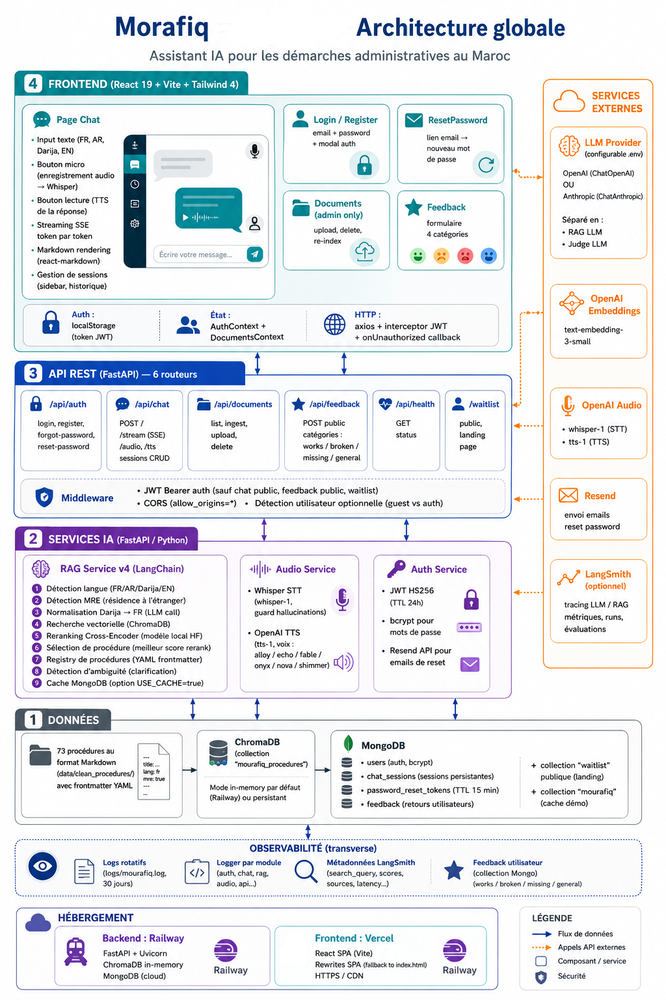

# System Architecture

Mourafiq follows a **Retrieval-Augmented Generation (RAG)** architecture designed to provide grounded answers about Moroccan administrative procedures.

The system combines a web-based frontend, a FastAPI backend, semantic retrieval, multilingual reranking, and an LLM-based generation layer.

The architecture below illustrates the main components and their interactions.

> **Architecture diagram:**



## 1. User Interface

The frontend is built with **React, TypeScript, and Vite**.

It provides the main interaction layer between the user and Mourafiq, including:

* Conversational interaction
* Streaming responses
* Feedback
* User procedures
* Voice interaction
* Session management

The frontend communicates with the backend through the API layer.

## 2. Backend API

The backend is implemented with **FastAPI** and acts as the main entry point for application requests.

It is responsible for:

* Receiving user queries
* Managing conversation sessions
* Processing requests
* Orchestrating the RAG pipeline
* Returning generated responses to the frontend
* Managing application-related operations

## 3. Query Processing

Before retrieval, the user's query goes through a preprocessing stage.

This stage can include:

* Language detection
* Query normalization
* Identification of the main administrative intent
* Handling of multilingual and Darija queries
* Consideration of conversational context

The objective is to transform the user's request into an effective search query while preserving its intended meaning.

## 4. Vector Retrieval

Mourafiq uses **ChromaDB** as its vector store.

The processed query is transformed into an embedding and used to retrieve potentially relevant administrative documents from the knowledge base.

This first retrieval stage provides a candidate set of documents for the next step.

## 5. Cross-Encoder Reranking

The retrieved candidates are then refined using a **multilingual cross-encoder reranker**.

Unlike the initial vector search, the reranker directly evaluates the relationship between the user's query and each candidate document.

This allows the system to prioritize the most relevant procedures before they are passed to the generation stage.

The reranking stage is particularly important for multilingual and naturally phrased administrative queries.

## 6. Context Selection

After reranking, the most relevant documents are selected as the context for generation.

The selected context provides the factual basis used by the language model to formulate the response.

This design helps reduce the risk of generating information that is not supported by the administrative knowledge base.

## 7. Response Generation

The selected context, the processed query, and the relevant conversation history are combined to construct the generation prompt.

The final response is generated using **Claude Haiku 4.5**.

The generation layer is designed to produce clear and grounded answers while supporting the different languages handled by Mourafiq.

## 8. Data and Persistence

The application uses:

* **ChromaDB** for vector-based document retrieval.
* **MongoDB** for application data and persistent information.
* The administrative corpus is built from structured procedure information verified against official sources.

The knowledge base contains **73 administrative procedures**, including variants relevant to Moroccan citizens living abroad.

## 9. Observability and Evaluation

**LangSmith** is integrated into the pipeline to provide tracing and evaluation capabilities.

The traced information can include:

* User/search query
* Query normalization
* Retrieved documents
* Relevance scores
* Selected procedure
* Prompt construction
* Conversation history
* Generated response

This makes it possible to analyze the behavior of the RAG pipeline and identify areas for improvement.

## 10. End-to-End Pipeline

At a high level, a user request follows this flow:

```text
User
  ↓
React / TypeScript Frontend
  ↓
FastAPI Backend
  ↓
Query Processing
  ↓
Vector Retrieval — ChromaDB
  ↓
Cross-Encoder Reranking
  ↓
Relevant Context Selection
  ↓
Prompt Construction
  ↓
Claude Haiku 4.5
  ↓
Generated Response
  ↓
Frontend
```

Throughout the pipeline, **LangSmith** provides tracing and observability.

## Architecture Principles

The architecture is built around three main principles:

* **Grounded generation:** responses are based on retrieved administrative information.
* **Multilingual interaction:** the system supports French, English, Standard Arabic, and Moroccan Darija.
* **Modular pipeline:** retrieval, reranking, context selection, generation, and evaluation are separated into distinct stages, making the system easier to analyze and improve.
