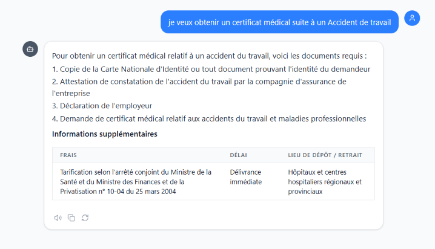
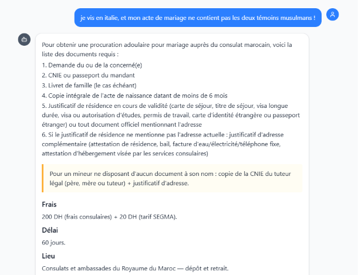
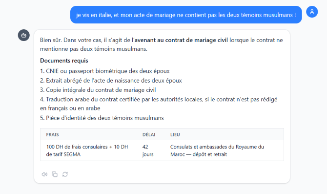
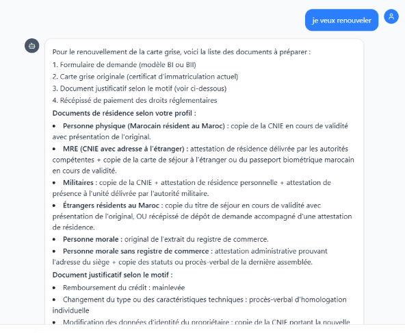
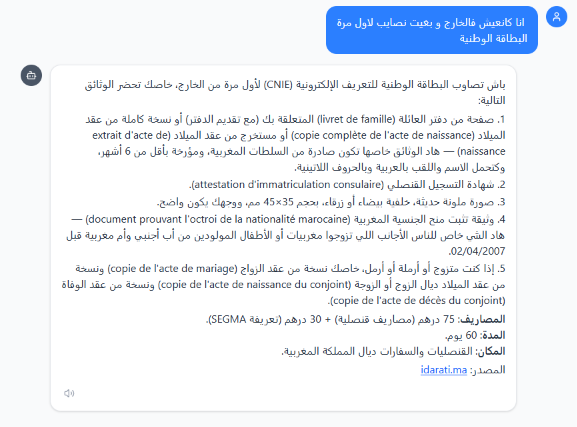
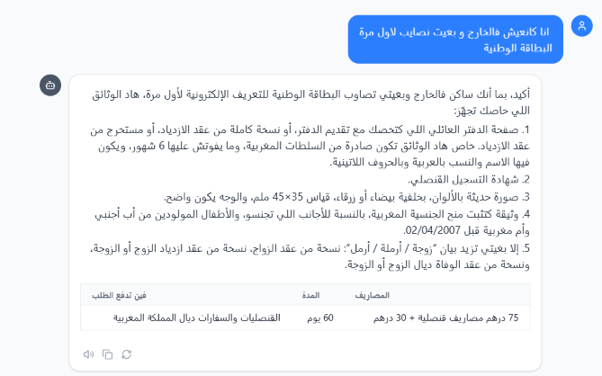

# Before / After Examples

This document presents four representative examples illustrating the evolution of **Morafiq** between the initial baseline version and the improved version.

The examples focus on the main limitations identified during the evaluation:

* Retrieval failures caused by irrelevant context
* Incorrect procedure identification
* Hallucinated or unsupported information
* Language mixing in generated responses

These examples complement the quantitative evaluation by showing how the implemented improvements affected the system's behavior on concrete administrative requests.

## 1. Retrieval Failure — Irrelevant Context

### User Query

> *"I want to obtain a medical certificate following a workplace accident."*

### Before / After Comparison

The baseline and improved responses are shown below.
> Baseline :


> Approved :


### Observed Improvement

The baseline system retrieved context that was not sufficiently aligned with the user's request.

The improved pipeline combines enhanced query processing, vector retrieval, and multilingual Cross-Encoder reranking to select context more closely related to the user's actual administrative intent.

---

## 2. Retrieval Failure — Incorrect Procedure Identification

### User Query

> *"I live in Italy, and my marriage certificate does not contain the two Muslim witnesses!"*

### Before / After Comparison

The comparison below illustrates the difference between the baseline and improved versions.

> Baseline :


> Approved :


### Observed Improvement

The baseline system could associate the request with an incorrect administrative procedure because of limitations in retrieval and procedure identification.

The improved system benefits from better retrieval and multilingual reranking, allowing the relevant procedure to be identified more reliably.

This example is particularly relevant to **MRE-related administrative scenarios**.

---

## 3. Reduction of Hallucinations

### User Query

> *"I want to renew..."*

### Before / After Comparison

The baseline and improved responses are shown below.

> Baseline :


> Approved :


### Observed Improvement

The baseline system could attempt to complete an incomplete request by generating information that was not sufficiently supported by the available context.

The improved system is designed to better recognize situations where the available information is insufficient to determine the intended procedure and can instead request clarification.

Stronger system prompting and improved context selection therefore help reduce unsupported information.

---

## 4. Reduction of Language Mixing

### User Query

> *[Multilingual administrative query]*

### Before / After Comparison

The following figure presents the baseline and improved responses.

> Baseline :


> Approved :


### Observed Improvement

The baseline response could contain unwanted language mixing, particularly when handling multilingual or Darija-based requests.

The improved pipeline applies multilingual query processing and stronger generation instructions to better preserve the language and intent of the user's request.

---

## 5. Improved Use of Conversation Context

An additional improvement was introduced to better handle **follow-up questions** using the current conversational context.

When a short follow-up question does not explicitly mention a new procedure, the system preserves the **currently identified procedure** and incorporates it into the search query.

For example, follow-up messages such as:

> *"I'm abroad."*

or

> *"And what about the fees?"*

can be interpreted in relation to the procedure already established in the conversation rather than as independent administrative requests.

The retrieval flow therefore becomes:

```text
User Query
    ↓
Current Procedure
    ↓
Retrieval
    ↓
Reranker
    ↓
Final Context
```

This approach improves conversational continuity and reduces the risk of switching to an unrelated procedure during follow-up interactions.

### Before / After Comparison

> Baseline :


> Approved :


---

## 6. What Changed?

The representative examples illustrate improvements across several stages of the RAG pipeline:

| Area                     | Before                                              | After                                               |
| ------------------------ | --------------------------------------------------- | --------------------------------------------------- |
| **Query Processing**     | Basic query processing                              | Improved normalization and context-aware processing |
| **Retrieval**            | Initial vector retrieval                            | Retrieval followed by relevance reranking           |
| **Ranking**              | Vector similarity                                   | Multilingual Cross-Encoder reranking                |
| **Procedure Selection**  | More susceptible to retrieval errors                | More targeted procedure identification              |
| **Clarification**        | Limited handling of incomplete or ambiguous queries | Improved clarification behavior                     |
| **Generation**           | Baseline prompting                                  | Stronger grounding and response instructions        |
| **Language Handling**    | Possible language mixing                            | More consistent multilingual responses              |
| **Conversation Context** | Follow-up questions treated more independently      | Current procedure preserved across follow-ups       |
| **Observability**        | Limited visibility into intermediate steps          | Detailed LangSmith traces                           |

## 7. Relationship with Quantitative Evaluation

The before/after examples complement the benchmark results presented in:

`evaluation/results.md`

While quantitative metrics provide aggregate measurements of system performance, individual examples make it possible to observe the **concrete behavioral changes** produced by the improvements.

Together, the two approaches provide complementary perspectives:

```text
Quantitative Evaluation
          +
Trace Analysis
          +
Before / After Examples
          ↓
Understanding System Improvements
```

## 8. Reproducibility and Public Disclosure

The examples included in the public repository should contain only information authorized for public disclosure.

Private benchmark data, internal documents, personal information, credentials, and proprietary content should not be included in the repository.
